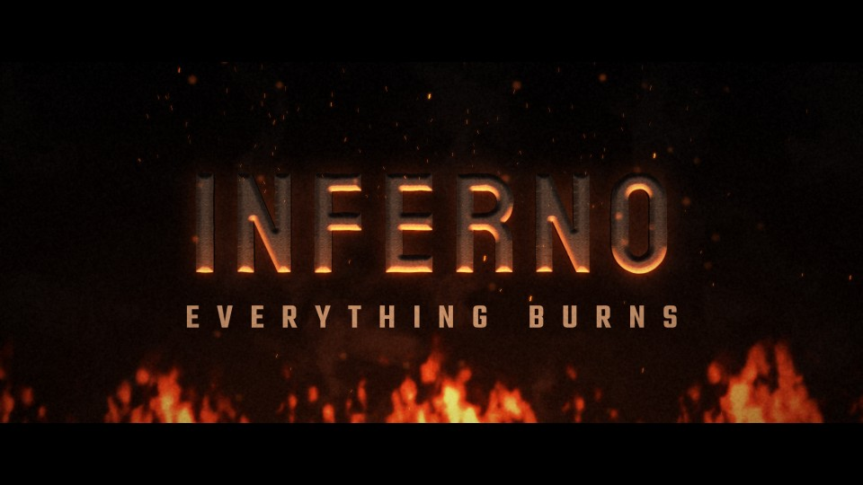

# T06 - Inferno Reveal

**Category:** B - Fire, Explosions and Impact  |  **Duration:** 192 frames (8.00s @ 24 fps)  |  **Depth:** 2.5D



The title emerges out of controlled firelight and smoke, seen through rising heat.

## Animation structure

| Phase | Default frames | What happens |
|---|---|---|
| Build-up | 0 - 39 | Behind a curtain of smoke and strong heat shimmer the title slowly comes forward; the smoke thins and the distortion settles as the fire rises behind it. |
| Impact / reveal | ~72 | A restrained flare: flames lick up, a burst of sparks rises and the orange rim light peaks, then settles. |
| Hero hold | 72 - 154 | Stable, readable title. Camera: Locked-off with a gentle forward creep; small heat-jolt at the flare. |
| Exit | 154 - 188 | The title burns away from the bottom up behind a glowing ember edge, releasing embers that rise with the heat. |

**Material / look:** Charred bronze lettering lit from below by the fire, orange rim from behind, warm halo for separation.

**Techniques:** procedural fire bed, heat-shimmer displacement, smoke curtain, rising sparks with DOF, flare burst, bottom-up burn-away with ember release

**Depth model:** **2.5D** (layered 2D compositing: masks, offset extrusion stack, parallax, light passes). No 3D geometry.

## Files

| File | Purpose |
|---|---|
| `source/T06_Inferno_Reveal.setting` | Fusion **macro** (editable title with published controls). Install as an Edit-page title or drag into the Fusion page. |
| `source/T06_Inferno_Reveal.comp` | Flat Fusion **composition** (83 tools) for Fusion Studio / Resolve Fusion page import. Final node: `Letterbox`. |
| `preview/T06_Inferno_Reveal.mp4` | 1920x1080 preview from the Python **reference renderer** (see note below). |
| `preview/thumbnail.jpg` | Hero-hold frame. |
| `configuration/render_profile.json` | Preview / 4K final render settings. |
| `configuration/default_params.json` | Reference-renderer defaults (edit + render with `render_title.py`). |
| `documentation/parameters.md` | Every published control and what it drives. |
| `documentation/sound_design.md` | Cue sheet (frames + seconds). |
| `manifest.json` | Machine-readable description and verification status. |

## Change the title text

**In Resolve (Edit page title):** select the clip, open the Inspector > *Title* tab > **Main Title** field. Font, size, letter spacing, line spacing, alignment and colour are next to it. Timing and look sliders (Impact Frame, Exit Start, Glow, Particles, Shake, ...) are on the same page under *Controls*.

**In the Fusion page:** select `MainTitle` (TextPlus) and edit *Styled Text*.

**Reference renderer (no Resolve needed):**
```
python 06_AUTOMATION/Scripts/render_title.py T06 --set MAIN_TITLE="YOUR TITLE" --set SUBTITLE="YOUR LINE" --out my_title.mp4
```

Default font: **Staatliches Regular** (OFL, bundled in `02_SHARED_ASSETS/Fonts/` - install it before opening the macro, or pick any installed font in the Inspector).

## Check in Resolve (unconfirmed input names)

These inputs are set in the macro but their names could not be confirmed against documentation. Fusion ignores unknown inputs when it loads a file, so if one is wrong only that setting falls back to its default. Check these first when you open the template:

`Displace.Foreground`, `pEmitter.Transform3DOp.Translate.Y`, `pRender.Height`, `pRender.UseFrameFormatSettings`, `pRender.Width`, `pTurbulence.XStrength`, `pTurbulence.YStrength`, `pTurbulence.ZStrength`

## Verification status (honest)

| Level | Status |
|---|---|
| A. Fusion source structure (real Lua parse, connections, expressions, published controls) | PASS / PASS |
| B. Standalone Python preview (ffprobe, duration, size, motion, exposure) | PASS |
| C. Composition loads in DaVinci Resolve | **BLOCKED** |
| D. Renders in DaVinci Resolve | **BLOCKED** |
| E. Text and controls editable in Resolve | **BLOCKED** |
| F. Visual comparison Resolve vs. preview | **BLOCKED** |

Resolve status: BLOCKED - not tested in DaVinci Resolve: no Resolve connection in the environment of run cloud_build_env_20261011 (see 06_AUTOMATION/Validation/resolve_test_results.json). To test it on your machine, see `06_AUTOMATION/Resolve/README.md`.

The preview was rendered by this project's Python reference renderer, which implements the same design, timing and controls but is **not** Fusion. Expect the Fusion render to differ in detail (noise character, particle look, glow falloff). See `COMPATIBILITY_REPORT.md` at the project root.
