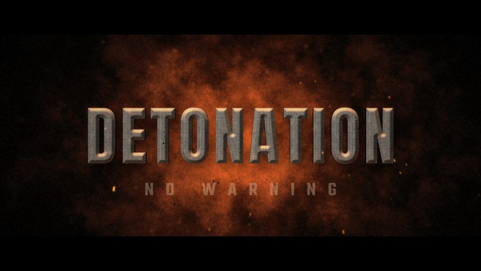

# T07 - Explosive Arrival

**Category:** B - Fire, Explosions and Impact  |  **Duration:** 144 frames (6.00s @ 24 fps)  |  **Depth:** 2.5D



A procedural detonation behind the title throws it into frame: fireball, smoke, shockwave and debris.

## Animation structure

| Phase | Default frames | What happens |
|---|---|---|
| Build-up | 0 - 14 | A short charged beat (ignition point flickering in the dark), then the blast hurls the title forward out of the fireball core with zoom blur. |
| Impact / reveal | ~24 | Expanding fireball cooling into billowing lit smoke, a fast shockwave ring with refraction, ballistic debris and embers - all behind/around the title, never permanently over it. |
| Hero hold | 24 - 114 | Stable, readable title. Camera: Locked-off, heavy concussive shake on detonation, then a very slow settle-in push. |
| Exit | 114 - 136 | The title rushes past camera (fly-through with zoom blur) as the smoke closes in. |

**Material / look:** Pale blast-worn concrete/steel plate, flat chamfer, fire rim light from behind, hard drop shadow on the smoke.

**Techniques:** procedural fireball (noise + radial density + temperature ramp), lit smoke billow, shockwave ring + displacement, ballistic debris (dark chunks + burning streaks), zoom-blur arrival, fly-through exit

**Depth model:** **2.5D** (layered 2D compositing: masks, offset extrusion stack, parallax, light passes). No 3D geometry.

## Files

| File | Purpose |
|---|---|
| `source/T07_Explosive_Arrival.setting` | Fusion **macro** (editable title with published controls). Install as an Edit-page title or drag into the Fusion page. |
| `source/T07_Explosive_Arrival.comp` | Flat Fusion **composition** (81 tools) for Fusion Studio / Resolve Fusion page import. Final node: `Letterbox`. |
| `preview/T07_Explosive_Arrival.mp4` | 1920x1080 preview from the Python **reference renderer** (see note below). |
| `preview/thumbnail.jpg` | Hero-hold frame. |
| `configuration/render_profile.json` | Preview / 4K final render settings. |
| `configuration/default_params.json` | Reference-renderer defaults (edit + render with `render_title.py`). |
| `documentation/parameters.md` | Every published control and what it drives. |
| `documentation/sound_design.md` | Cue sheet (frames + seconds). |
| `manifest.json` | Machine-readable description and verification status. |

## Change the title text

**In Resolve (Edit page title):** select the clip, open the Inspector > *Title* tab > **Main Title** field. Font, size, letter spacing, line spacing, alignment and colour are next to it. Timing and look sliders (Impact Frame, Exit Start, Glow, Particles, Shake, ...) are on the same page under *Controls*.

**In the Fusion page:** select `MainTitle` (TextPlus) and edit *Styled Text*.

**Reference renderer (no Resolve needed):**
```
python 06_AUTOMATION/Scripts/render_title.py T07 --set MAIN_TITLE="YOUR TITLE" --set SUBTITLE="YOUR LINE" --out my_title.mp4
```

Default font: **Anton Regular** (OFL, bundled in `02_SHARED_ASSETS/Fonts/` - install it before opening the macro, or pick any installed font in the Inspector).

## Fusion notes and limitations

- Debris on/off: set Particle Intensity to 0 to disable all debris and embers (DebrisEmitter/EmberEmitter Number = count x ParticleIntensity); values between 0 and 2 scale the amount.
- Explosion strength: Impact Intensity scales fireball size and brightness, the flash, both shockwave rings and the shockwave refraction (0 = title arrives without the blast).
- The fireball is FastNoise inside an expanding soft EllipseMask; to re-centre the blast move FireballShape, FireCoreShape, SmokeShape, ShockRingA/B Shape centres together.

## Check in Resolve (unconfirmed input names)

These inputs are set in the macro but their names could not be confirmed against documentation. Fusion ignores unknown inputs when it loads a file, so if one is wrong only that setting falls back to its default. Check these first when you open the template:

`Displace.Foreground`, `pDirectionalForce.Direction`, `pDirectionalForce.Strength`, `pEmitter.Transform3DOp.Translate.Y`, `pRender.Height`, `pRender.UseFrameFormatSettings`, `pRender.Width`, `pTurbulence.XStrength`, `pTurbulence.YStrength`, `pTurbulence.ZStrength`

## Verification status (honest)

| Level | Status |
|---|---|
| A. Fusion source structure (real Lua parse, connections, expressions, published controls) | PASS / PASS |
| B. Standalone Python preview (ffprobe, duration, size, motion, exposure) | PASS |
| C. Composition loads in DaVinci Resolve | **BLOCKED** |
| D. Renders in DaVinci Resolve | **BLOCKED** |
| E. Text and controls editable in Resolve | **BLOCKED** |
| F. Visual comparison Resolve vs. preview | **BLOCKED** |

Resolve status: BLOCKED - not tested in DaVinci Resolve: no Resolve connection in the environment of run cloud_build_env_20261011 (see 06_AUTOMATION/Validation/resolve_test_results.json). To test it on your machine, see `06_AUTOMATION/Resolve/README.md`.

The preview was rendered by this project's Python reference renderer, which implements the same design, timing and controls but is **not** Fusion. Expect the Fusion render to differ in detail (noise character, particle look, glow falloff). See `COMPATIBILITY_REPORT.md` at the project root.
