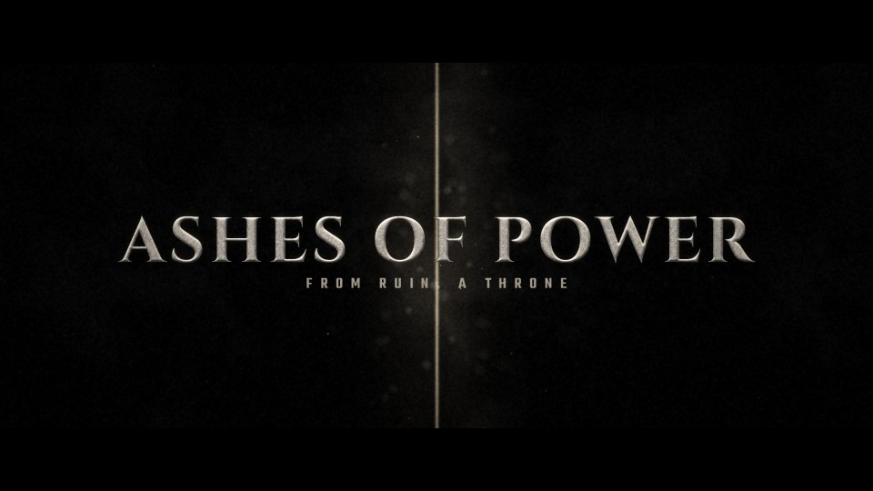

# T09 - Ashes of Power

**Category:** B - Fire, Explosions and Impact  |  **Duration:** 204 frames (8.50s @ 24 fps)  |  **Depth:** 2.5D



Power rebuilt from ruin: falling ash and black dust are drawn together into solid lettering.

## Animation structure

| Phase | Default frames | What happens |
|---|---|---|
| Build-up | 0 - 52 | Ash drifts down through a dark void; grains peel off their fall and travel on curved paths onto points of the letter shapes, accumulating until the letters exist as dusty forms. |
| Impact / reveal | ~96 | On the impact frame the dust compacts into a solid, stable title; a controlled puff and a backlight pulse. |
| Hero hold | 96 - 166 | Stable, readable title. Camera: Slow push-in while the camera drifts gently downward with the ash. |
| Exit | 166 - 202 | An erosion front crosses the title left to right; the released ash falls away under gravity. |

**Material / look:** Compacted ash / charcoal-stone with grainy bump, pale rim from a narrow vertical backlight slit.

**Techniques:** targeted particle convergence onto glyph samples, granular accumulation mask, narrow vertical slit backlight, falling ash with flutter, compaction pulse, gravity crumble exit

**Depth model:** **2.5D** (layered 2D compositing: masks, offset extrusion stack, parallax, light passes). No 3D geometry.

## Files

| File | Purpose |
|---|---|
| `source/T09_Ashes_of_Power.setting` | Fusion **macro** (editable title with published controls). Install as an Edit-page title or drag into the Fusion page. |
| `source/T09_Ashes_of_Power.comp` | Flat Fusion **composition** (85 tools) for Fusion Studio / Resolve Fusion page import. Final node: `Letterbox`. |
| `preview/T09_Ashes_of_Power.mp4` | 1920x1080 preview from the Python **reference renderer** (see note below). |
| `preview/thumbnail.jpg` | Hero-hold frame. |
| `configuration/render_profile.json` | Preview / 4K final render settings. |
| `configuration/default_params.json` | Reference-renderer defaults (edit + render with `render_title.py`). |
| `documentation/parameters.md` | Every published control and what it drives. |
| `documentation/sound_design.md` | Cue sheet (frames + seconds). |
| `manifest.json` | Machine-readable description and verification status. |

## Change the title text

**In Resolve (Edit page title):** select the clip, open the Inspector > *Title* tab > **Main Title** field. Font, size, letter spacing, line spacing, alignment and colour are next to it. Timing and look sliders (Impact Frame, Exit Start, Glow, Particles, Shake, ...) are on the same page under *Controls*.

**In the Fusion page:** select `MainTitle` (TextPlus) and edit *Styled Text*.

**Reference renderer (no Resolve needed):**
```
python 06_AUTOMATION/Scripts/render_title.py T09 --set MAIN_TITLE="YOUR TITLE" --set SUBTITLE="YOUR LINE" --out my_title.mp4
```

Default font: **Cinzel Bold** (OFL, bundled in `02_SHARED_ASSETS/Fonts/` - install it before opening the macro, or pick any installed font in the Inspector).

## Check in Resolve (unconfirmed input names)

These inputs are set in the macro but their names could not be confirmed against documentation. Fusion ignores unknown inputs when it loads a file, so if one is wrong only that setting falls back to its default. Check these first when you open the template:

`pEmitter.Transform3DOp.Translate.Y`, `pRender.Height`, `pRender.UseFrameFormatSettings`, `pRender.Width`, `pTurbulence.XStrength`, `pTurbulence.YStrength`, `pTurbulence.ZStrength`

## Verification status (honest)

| Level | Status |
|---|---|
| Fusion source parses as Lua table (real Lua interpreter) | PASS |
| Graph structure (connections, expression references, published controls) | PASS |
| Opened / rendered inside DaVinci Resolve or Fusion | **NOT TESTED (DaVinci Resolve/Fusion not available in the build environment)** |
| Preview video rendered and checked (ffprobe, duration, size, non-black) | PASS |

The preview was rendered by this project's Python reference renderer, which implements the same design, timing and controls but is **not** Fusion. Expect the Fusion render to differ in detail (noise character, particle look, glow falloff). See `COMPATIBILITY_REPORT.md` at the project root.
