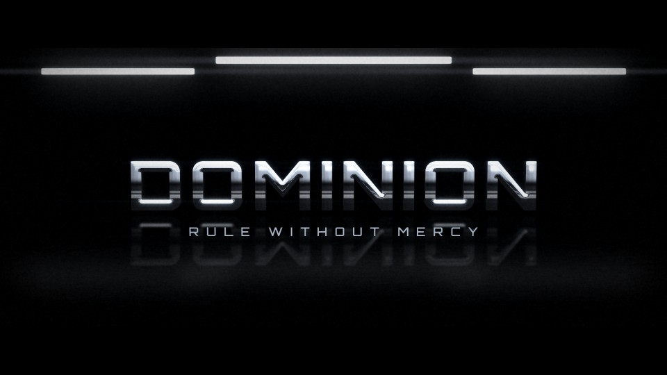

# T12 - Chrome Dominion

**Category:** C - 3D Metal and Premium Materials  |  **Duration:** 180 frames (7.50s @ 24 fps)  |  **Depth:** 3D



A mirror-chrome monolith title stands up in a black studio lit only by hard strip softboxes.

## Animation structure

| Phase | Default frames | What happens |
|---|---|---|
| Build-up | 0 - 57 | Studio strip lights clunk on one by one; the chrome title, lying back on the glossy floor, pivots upright on its base (X rotation 78 deg to 0) toward a low-angle camera. |
| Impact / reveal | ~74 | At the lock the strip-light reflections race across the chrome faces, a cold edge light snaps on and the floor mirror catches the full title. |
| Hero hold | 74 - 140 | Stable, readable title. Camera: Low-angle dolly-in that rises slightly to eye level; compact shake at the lock. |
| Exit | 140 - 166 | The title falls back flat into the floor reflection while the strip lights switch off in reverse order. |

**Material / look:** Mirror chrome: near-zero diffuse, very high specular exponent, layered strip reflections over a black horizon band, crisp bevels with cool edge illumination, dark extruded walls.

**Techniques:** Text3D extrusion, pivot-up reveal, strip-light reflections, edge illumination, mirror floor, sequential light rig, fall-back exit

**Depth model:** **Genuine 3D** in the Fusion source (Text3D extrusion + Blinn material + lights + Camera3D + Renderer3D).

## Files

| File | Purpose |
|---|---|
| `source/T12_Chrome_Dominion.setting` | Fusion **macro** (editable title with published controls). Install as an Edit-page title or drag into the Fusion page. |
| `source/T12_Chrome_Dominion.comp` | Flat Fusion **composition** (59 tools) for Fusion Studio / Resolve Fusion page import. Final node: `Letterbox`. |
| `preview/T12_Chrome_Dominion.mp4` | 1920x1080 preview from the Python **reference renderer** (see note below). |
| `preview/thumbnail.jpg` | Hero-hold frame. |
| `configuration/render_profile.json` | Preview / 4K final render settings. |
| `configuration/default_params.json` | Reference-renderer defaults (edit + render with `render_title.py`). |
| `documentation/parameters.md` | Every published control and what it drives. |
| `documentation/sound_design.md` | Cue sheet (frames + seconds). |
| `manifest.json` | Machine-readable description and verification status. |

## Change the title text

**In Resolve (Edit page title):** select the clip, open the Inspector > *Title* tab > **Main Title** field. Font, size, letter spacing, line spacing, alignment and colour are next to it. Timing and look sliders (Impact Frame, Exit Start, Glow, Particles, Shake, ...) are on the same page under *Controls*.

**In the Fusion page:** select `MainTitle` (TextPlus, or the Text3D node) and edit *Styled Text*.

**Reference renderer (no Resolve needed):**
```
python 06_AUTOMATION/Scripts/render_title.py T12 --set MAIN_TITLE="YOUR TITLE" --set SUBTITLE="YOUR LINE" --out my_title.mp4
```

Default font: **Orbitron Black** (OFL, bundled in `02_SHARED_ASSETS/Fonts/` - install it before opening the macro, or pick any installed font in the Inspector).

## Fusion notes and limitations

- Approximation: the Fusion MtlBlinn cannot reflect an environment, so the chrome look is built from a very high specular exponent, three animated spot/directional highlights and screen-space strip reflections (masked light sweeps). For true mirror chrome, replace GoldMtl-style Blinn ('ChromeMtl') with a MtlReflect fed by an HDRI SphereMap - not generated because those tool IDs are unverified here.
- The floor reflection is a flipped 2D copy of the rendered title (Transform FlipVert), not a ray-traced mirror; it stays correct while the title is upright and is faded out during the fall-back exit.

## Check in Resolve (unconfirmed input names)

These inputs are set in the macro but their names could not be confirmed against documentation. Fusion ignores unknown inputs when it loads a file, so if one is wrong only that setting falls back to its default. Check these first when you open the template:

`Renderer3D.RendererOpenGL.LightingEnabled`, `Renderer3D.RendererOpenGL.Supersampling`, `Transform.FlipVert`

## Verification status (honest)

| Level | Status |
|---|---|
| Fusion source parses as Lua table (real Lua interpreter) | PASS |
| Graph structure (connections, expression references, published controls) | PASS |
| Opened / rendered inside DaVinci Resolve or Fusion | **NOT TESTED (DaVinci Resolve/Fusion not available in the build environment)** |
| Preview video rendered and checked (ffprobe, duration, size, non-black) | PASS |

The preview was rendered by this project's Python reference renderer, which implements the same design, timing and controls but is **not** Fusion. Expect the Fusion render to differ in detail (noise character, particle look, glow falloff). See `COMPATIBILITY_REPORT.md` at the project root.
