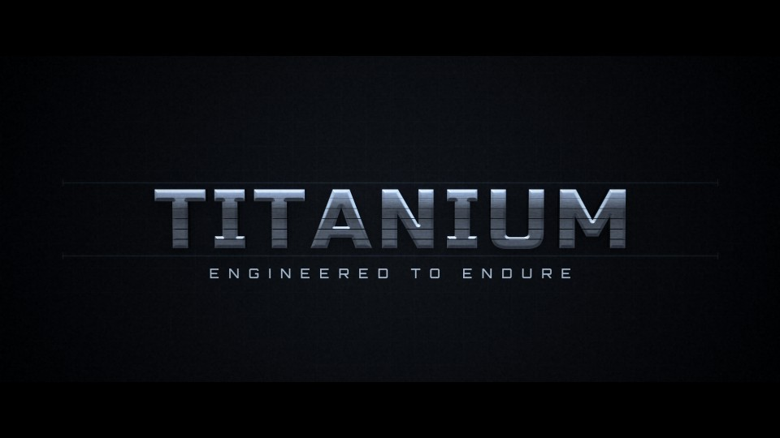

# T13 - Titanium Edge

**Category:** C - 3D Metal and Premium Materials  |  **Duration:** 168 frames (7.00s @ 24 fps)  |  **Depth:** 3D



Precision-machined titanium lettering assembled like a mechanism from horizontal slats.

## Animation structure

| Phase | Default frames | What happens |
|---|---|---|
| Build-up | 0 - 37 | Guide rails draw on, then six horizontal slats of the extruded titanium title slide in from alternating sides, out of depth, locking into alignment one by one with a crisp mechanical snap. |
| Impact / reveal | ~62 | The final slat locks on the impact frame: a cold seam flash runs along each joint and a narrow silver-blue highlight cuts across the chamfered edges. |
| Hero hold | 62 - 128 | Stable, readable title. Camera: Slight three-quarter angle that squares up with a measured dolly; micro-jolt on each lock. |
| Exit | 128 - 154 | The slats close like blinds - each band collapses to a thin line in sequence - and the rails retract. |

**Material / look:** Cold brushed titanium: anisotropic brushed texture, flat chamfer bevel, narrow high-exponent silver-blue specular, cool environment reflection, dark gunmetal sides.

**Techniques:** Text3D extrusion, rectangle-masked slats, staggered mechanical slide, seam flashes, narrow spec sweep, technical grid + rails, blinds exit

**Depth model:** **Genuine 3D** in the Fusion source (Text3D extrusion + Blinn material + lights + Camera3D + Renderer3D).

## Files

| File | Purpose |
|---|---|
| `source/T13_Titanium_Edge.setting` | Fusion **macro** (editable title with published controls). Install as an Edit-page title or drag into the Fusion page. |
| `source/T13_Titanium_Edge.comp` | Flat Fusion **composition** (72 tools) for Fusion Studio / Resolve Fusion page import. Final node: `Letterbox`. |
| `preview/T13_Titanium_Edge.mp4` | 1920x1080 preview from the Python **reference renderer** (see note below). |
| `preview/thumbnail.jpg` | Hero-hold frame. |
| `configuration/render_profile.json` | Preview / 4K final render settings. |
| `configuration/default_params.json` | Reference-renderer defaults (edit + render with `render_title.py`). |
| `documentation/parameters.md` | Every published control and what it drives. |
| `documentation/sound_design.md` | Cue sheet (frames + seconds). |
| `manifest.json` | Machine-readable description and verification status. |

## Change the title text

**In Resolve (Edit page title):** select the clip, open the Inspector > *Title* tab > **Main Title** field. Font, size, letter spacing, line spacing, alignment and colour are next to it. Timing and look sliders (Impact Frame, Exit Start, Glow, Particles, Shake, ...) are on the same page under *Controls*.

**In the Fusion page:** select `MainTitle` (TextPlus, or the Text3D node) and edit *Styled Text*.

**Reference renderer (no Resolve needed):**
```
python 06_AUTOMATION/Scripts/render_title.py T13 --set MAIN_TITLE="YOUR TITLE" --set SUBTITLE="YOUR LINE" --out my_title.mp4
```

Default font: **Russo One Regular** (OFL, bundled in `02_SHARED_ASSETS/Fonts/` - install it before opening the macro, or pick any installed font in the Inspector).

## Fusion notes and limitations

- Slats are rectangle-masked copies of the single Renderer3D output, each moved by its own Transform. If you change the title size or line count, adjust the slat masks' Center/Height (SlatNShape) so the bands still cover the letters.

## Check in Resolve (unconfirmed input names)

These inputs are set in the macro but their names could not be confirmed against documentation. Fusion ignores unknown inputs when it loads a file, so if one is wrong only that setting falls back to its default. Check these first when you open the template:

`Renderer3D.RendererOpenGL.LightingEnabled`, `Renderer3D.RendererOpenGL.Supersampling`

## Verification status (honest)

| Level | Status |
|---|---|
| A. Fusion source structure (real Lua parse, connections, expressions, published controls) | PASS / PASS |
| B. Standalone Python preview (ffprobe, duration, size, motion, exposure) | PASS |
| C. Composition loads in DaVinci Resolve | **BLOCKED** |
| D. Renders in DaVinci Resolve | **BLOCKED** |
| E. Text and controls editable in Resolve | **BLOCKED** |
| F. Visual comparison Resolve vs. preview | **BLOCKED** |

Resolve status: BLOCKED - not tested in DaVinci Resolve: no Resolve connection in the environment of run cloud_build_env_20261011 (see 06_AUTOMATION/Validation/resolve_test_results.json). To test it on your machine, see `06_AUTOMATION/Resolve/README.md`.

The preview was rendered by this project's Python reference renderer, which implements the same design, timing and controls but is **not** Fusion. Expect the Fusion render to differ in detail (noise character, particle look, glow falloff). See `COMPATIBILITY_REPORT.md` at the project root.
