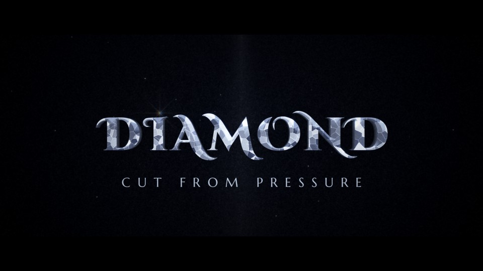

# T15 - Diamond Cut

**Category:** C - 3D Metal and Premium Materials  |  **Duration:** 204 frames (8.50s @ 24 fps)  |  **Depth:** 3D



A flawless, faceted crystal title displayed like a jewel on midnight velvet.

## Animation structure

| Phase | Default frames | What happens |
|---|---|---|
| Build-up | 0 - 51 | A controlled orbit: the camera arcs around the cut-crystal title (yaw 55 deg and a slight pitch resolving to front-on) while hundreds of facets catch and lose the light. |
| Impact / reveal | ~96 | On the impact frame the orbit settles, the display spotlight brightens and one star-shaped glint with a faint spectral fringe fires from a letter crown; facets keep scintillating gently. |
| Hero hold | 96 - 164 | Stable, readable title. Camera: Measured orbit + dolly that decelerates into a locked front view; no shake. |
| Exit | 164 - 196 | The title turns away in the opposite direction as the spotlight closes, leaving a last glint. |

**Material / look:** Faceted crystal: Voronoi facet planes with per-facet specular flashes driven by the view angle, sharp flat chamfer bevel (crown), cool environment reflection, restrained dispersion (2-3 px RGB split on the brightest sparkles only).

**Techniques:** Text3D extrusion, camera orbit, facet scintillation, restrained dispersion, star glints, caustic velvet backdrop, spotlight close exit

**Depth model:** **Genuine 3D** in the Fusion source (Text3D extrusion + Blinn material + lights + Camera3D + Renderer3D).

## Files

| File | Purpose |
|---|---|
| `source/T15_Diamond_Cut.setting` | Fusion **macro** (editable title with published controls). Install as an Edit-page title or drag into the Fusion page. |
| `source/T15_Diamond_Cut.comp` | Flat Fusion **composition** (46 tools) for Fusion Studio / Resolve Fusion page import. Final node: `Letterbox`. |
| `preview/T15_Diamond_Cut.mp4` | 1920x1080 preview from the Python **reference renderer** (see note below). |
| `preview/thumbnail.jpg` | Hero-hold frame. |
| `configuration/render_profile.json` | Preview / 4K final render settings. |
| `configuration/default_params.json` | Reference-renderer defaults (edit + render with `render_title.py`). |
| `documentation/parameters.md` | Every published control and what it drives. |
| `documentation/sound_design.md` | Cue sheet (frames + seconds). |
| `manifest.json` | Machine-readable description and verification status. |

## Change the title text

**In Resolve (Edit page title):** select the clip, open the Inspector > *Title* tab > **Main Title** field. Font, size, letter spacing, line spacing, alignment and colour are next to it. Timing and look sliders (Impact Frame, Exit Start, Glow, Particles, Shake, ...) are on the same page under *Controls*.

**In the Fusion page:** select `MainTitle` (TextPlus, or the Text3D node) and edit *Styled Text*.

**Reference renderer (no Resolve needed):**
```
python 06_AUTOMATION/Scripts/render_title.py T15 --set MAIN_TITLE="YOUR TITLE" --set SUBTITLE="YOUR LINE" --out my_title.mp4
```

Default font: **Cinzel Decorative Black** (OFL, bundled in `02_SHARED_ASSETS/Fonts/` - install it before opening the macro, or pick any installed font in the Inspector).

## Fusion notes and limitations

- Facet scintillation in Fusion is approximated by a discontinuous FastNoise cell pattern clipped to the rendered title and modulated by the camera orbit; Text3D itself has smooth faces (no real facets).
- Dispersion is limited to a subtle tinted sweep; enable chromatic aberration in your grade if you want more prismatic separation (keep it restrained for readability).

## Check in Resolve (unconfirmed input names)

These inputs are set in the macro but their names could not be confirmed against documentation. Fusion ignores unknown inputs when it loads a file, so if one is wrong only that setting falls back to its default. Check these first when you open the template:

`Renderer3D.RendererOpenGL.LightingEnabled`, `Renderer3D.RendererOpenGL.Supersampling`

## Verification status (honest)

| Level | Status |
|---|---|
| Fusion source parses as Lua table (real Lua interpreter) | PASS |
| Graph structure (connections, expression references, published controls) | PASS |
| Opened / rendered inside DaVinci Resolve or Fusion | **NOT TESTED (DaVinci Resolve/Fusion not available in the build environment)** |
| Preview video rendered and checked (ffprobe, duration, size, non-black) | PASS |

The preview was rendered by this project's Python reference renderer, which implements the same design, timing and controls but is **not** Fusion. Expect the Fusion render to differ in detail (noise character, particle look, glow falloff). See `COMPATIBILITY_REPORT.md` at the project root.
