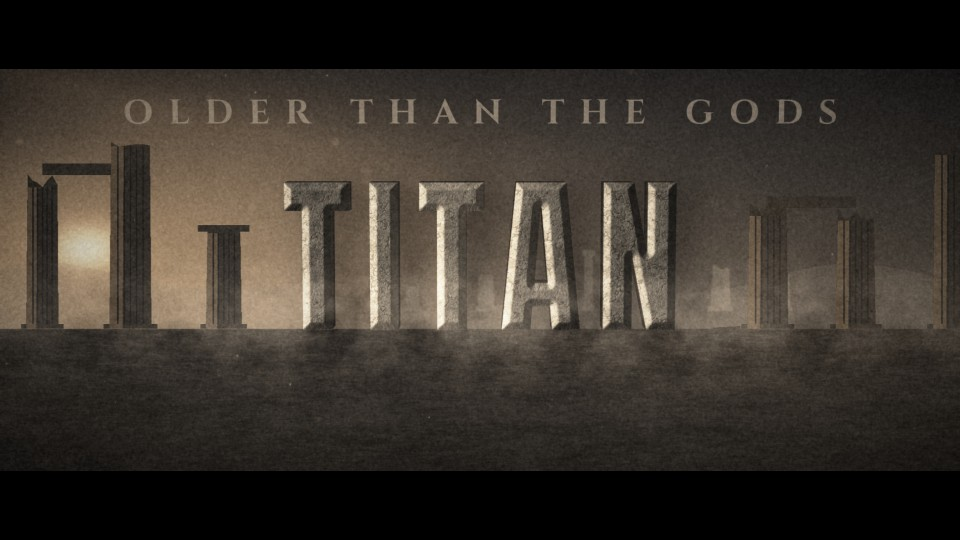

# T16 - Ancient Titan

**Category:** D - Mythic, Epic and Fantasy  |  **Duration:** 240 frames (10.00s @ 24 fps)  |  **Depth:** 2.5D



A colossal carved-stone title rises out of the ground of a ruined, hazy ancient valley.

## Animation structure

| Phase | Default frames | What happens |
|---|---|---|
| Build-up | 0 - 64 | Under a continuous low rumble the monumental stone letters grind up out of the earth, shedding dust and grit, while ground dust billows along their base. |
| Impact / reveal | ~112 | On the impact frame the title settles to full height with a heavy thud: a ground-hugging dust wave rolls outward and a shaft of low sun rakes across the carved faces. |
| Hero hold | 112 - 186 | Stable, readable title. Camera: Low worm's-eye angle, slow upward tilt with parallax between ruin layers; rumble shake while rising. |
| Exit | 186 - 230 | Haze thickens and rolls across the valley, swallowing the title into atmosphere. |

**Material / look:** Weathered sandstone: stone texture bump, flat-cut chamfer, hard directional side-light from the left, deep 2.5D extrusion stack; atmospheric perspective on the ruins.

**Techniques:** 2.5D extrusion stack, ground-occluded rise, ruin parallax layers, atmospheric perspective, dust shed + ground dust wave, raking sun shaft, haze swallow exit

**Depth model:** **2.5D** (layered 2D compositing: masks, offset extrusion stack, parallax, light passes). No 3D geometry.

## Files

| File | Purpose |
|---|---|
| `source/T16_Ancient_Titan.setting` | Fusion **macro** (editable title with published controls). Install as an Edit-page title or drag into the Fusion page. |
| `source/T16_Ancient_Titan.comp` | Flat Fusion **composition** (95 tools) for Fusion Studio / Resolve Fusion page import. Final node: `Letterbox`. |
| `preview/T16_Ancient_Titan.mp4` | 1920x1080 preview from the Python **reference renderer** (see note below). |
| `preview/thumbnail.jpg` | Hero-hold frame. |
| `configuration/render_profile.json` | Preview / 4K final render settings. |
| `configuration/default_params.json` | Reference-renderer defaults (edit + render with `render_title.py`). |
| `documentation/parameters.md` | Every published control and what it drives. |
| `documentation/sound_design.md` | Cue sheet (frames + seconds). |
| `manifest.json` | Machine-readable description and verification status. |

## Change the title text

**In Resolve (Edit page title):** select the clip, open the Inspector > *Title* tab > **Main Title** field. Font, size, letter spacing, line spacing, alignment and colour are next to it. Timing and look sliders (Impact Frame, Exit Start, Glow, Particles, Shake, ...) are on the same page under *Controls*.

**In the Fusion page:** select `MainTitle` (TextPlus) and edit *Styled Text*.

**Reference renderer (no Resolve needed):**
```
python 06_AUTOMATION/Scripts/render_title.py T16 --set MAIN_TITLE="YOUR TITLE" --set SUBTITLE="YOUR LINE" --out my_title.mp4
```

Default font: **Anton Regular** (OFL, bundled in `02_SHARED_ASSETS/Fonts/` - install it before opening the macro, or pick any installed font in the Inspector).

## Check in Resolve (unconfirmed input names)

These inputs are set in the macro but their names could not be confirmed against documentation. Fusion ignores unknown inputs when it loads a file, so if one is wrong only that setting falls back to its default. Check these first when you open the template:

`pEmitter.Transform3DOp.Translate.Y`, `pRender.Height`, `pRender.UseFrameFormatSettings`, `pRender.Width`, `pTurbulence.XStrength`, `pTurbulence.YStrength`, `pTurbulence.ZStrength`

## Verification status (honest)

| Level | Status |
|---|---|
| A. Fusion source structure (real Lua parse, connections, expressions, published controls) | PASS / PASS |
| B. Standalone Python preview (ffprobe, duration, size, motion, exposure) | PASS |
| C. Composition loads in DaVinci Resolve | **BLOCKED** |
| D. Renders in DaVinci Resolve | **BLOCKED** |
| E. Text and controls editable in Resolve | **BLOCKED** |
| F. Visual comparison Resolve vs. preview | **BLOCKED** |

Resolve status: BLOCKED - not tested in DaVinci Resolve: no Resolve connection in the environment of run cloud_build_env_20261011 (see 06_AUTOMATION/Validation/resolve_test_results.json). To test it on your machine, see `06_AUTOMATION/Resolve/README.md`.

The preview was rendered by this project's Python reference renderer, which implements the same design, timing and controls but is **not** Fusion. Expect the Fusion render to differ in detail (noise character, particle look, glow falloff). See `COMPATIBILITY_REPORT.md` at the project root.
