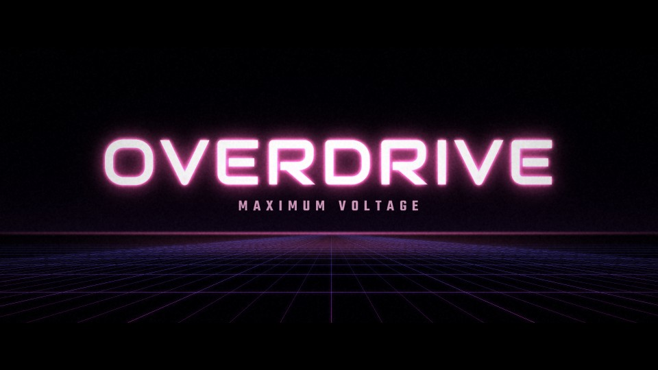

# T21 - Neon Overdrive

**Category:** E - Sci-Fi and Futuristic Motion Graphics  |  **Duration:** 168 frames (7.00s @ 24 fps)  |  **Depth:** 2.5D



A night-drive title: neon tubes ignite around the letterforms above a receding light grid.

## Animation structure

| Phase | Default frames | What happens |
|---|---|---|
| Build-up | 0 - 31 | Camera glides over a receding neon floor grid (fast, then decelerating) while a neon tube traces the letter edges left-to-right with short starter flickers. |
| Impact / reveal | ~60 | At the impact frame the letter faces power up with a single digital slice-distortion hit. |
| Hero hold | 60 - 126 | Stable, readable title. Camera: Low forward glide over the grid that brakes into a slow drift; no shake (energy is in the light). |
| Exit | 126 - 158 | Power-down: the tubes cut out right-to-left with a stutter, faces drain, the grid goes dark from the horizon. |

**Material / look:** Dark glass faces that fill with cool white light; magenta (ACCENT) neon tube inside the letter edge.

**Techniques:** perspective floor grid, edge-tube draw-on, starter flicker, slice distortion, floor glow pool, power-down wipe

**Depth model:** **2.5D** (layered 2D compositing: masks, offset extrusion stack, parallax, light passes). No 3D geometry.

## Files

| File | Purpose |
|---|---|
| `source/T21_Neon_Overdrive.setting` | Fusion **macro** (editable title with published controls). Install as an Edit-page title or drag into the Fusion page. |
| `source/T21_Neon_Overdrive.comp` | Flat Fusion **composition** (71 tools) for Fusion Studio / Resolve Fusion page import. Final node: `Letterbox`. |
| `preview/T21_Neon_Overdrive.mp4` | 1920x1080 preview from the Python **reference renderer** (see note below). |
| `preview/thumbnail.jpg` | Hero-hold frame. |
| `configuration/render_profile.json` | Preview / 4K final render settings. |
| `configuration/default_params.json` | Reference-renderer defaults (edit + render with `render_title.py`). |
| `documentation/parameters.md` | Every published control and what it drives. |
| `documentation/sound_design.md` | Cue sheet (frames + seconds). |
| `manifest.json` | Machine-readable description and verification status. |

## Change the title text

**In Resolve (Edit page title):** select the clip, open the Inspector > *Title* tab > **Main Title** field. Font, size, letter spacing, line spacing, alignment and colour are next to it. Timing and look sliders (Impact Frame, Exit Start, Glow, Particles, Shake, ...) are on the same page under *Controls*.

**In the Fusion page:** select `MainTitle` (TextPlus) and edit *Styled Text*.

**Reference renderer (no Resolve needed):**
```
python 06_AUTOMATION/Scripts/render_title.py T21 --set MAIN_TITLE="YOUR TITLE" --set SUBTITLE="YOUR LINE" --out my_title.mp4
```

Default font: **Audiowide Regular** (OFL, bundled in `02_SHARED_ASSETS/Fonts/` - install it before opening the macro, or pick any installed font in the Inspector).

## Fusion notes and limitations

- Floor grid lines are PolylineMask/RectangleMask shapes in the 'FloorGrid*' nodes; move 'GridLinesV*' points to change the vanishing point.

## Check in Resolve (unconfirmed input names)

These inputs are set in the macro but their names could not be confirmed against documentation. Fusion ignores unknown inputs when it loads a file, so if one is wrong only that setting falls back to its default. Check these first when you open the template:

`Transform.EffectMask`

## Verification status (honest)

| Level | Status |
|---|---|
| Fusion source parses as Lua table (real Lua interpreter) | PASS |
| Graph structure (connections, expression references, published controls) | PASS |
| Opened / rendered inside DaVinci Resolve or Fusion | **NOT TESTED (DaVinci Resolve/Fusion not available in the build environment)** |
| Preview video rendered and checked (ffprobe, duration, size, non-black) | PASS |

The preview was rendered by this project's Python reference renderer, which implements the same design, timing and controls but is **not** Fusion. Expect the Fusion render to differ in detail (noise character, particle look, glow falloff). See `COMPATIBILITY_REPORT.md` at the project root.
