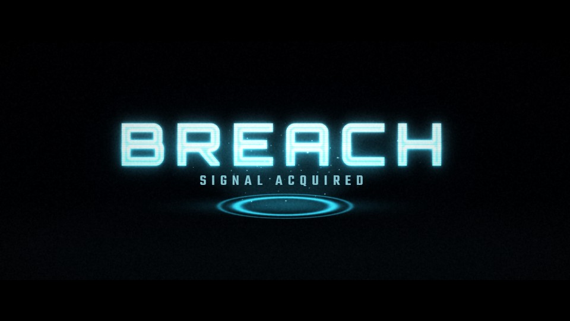

# T22 - Hologram Breach

**Category:** E - Sci-Fi and Futuristic Motion Graphics  |  **Duration:** 192 frames (8.00s @ 24 fps)  |  **Depth:** 2.5D



The title is a projected hologram: a floor emitter throws a light beam and the wordmark assembles in it.

## Animation structure

| Phase | Default frames | What happens |
|---|---|---|
| Build-up | 0 - 41 | Emitter pad powers on and opens a volumetric beam; the title materialises as horizontal scan segments in a designed non-sequential order, each sliding into register with a short blink. |
| Impact / reveal | ~76 | At the impact frame a lock-in scan pass sweeps the title: interference stops and the image stabilises. |
| Hero hold | 76 - 150 | Stable, readable title. Camera: Locked-off with a slow lateral parallax drift; no shake (precision device). |
| Exit | 150 - 178 | Projector cut: the hologram collapses vertically into the beam, the beam retracts into the emitter. |

**Material / look:** Emissive cyan light: scan lines, brighter edge fresnel, bottom-up projector falloff, faint interference.

**Techniques:** segmented scan assembly, scan lines, interference glitch (controllable), volumetric beam, emitter ring, beam dust, vertical collapse exit

**Depth model:** **2.5D** (layered 2D compositing: masks, offset extrusion stack, parallax, light passes). No 3D geometry.

## Files

| File | Purpose |
|---|---|
| `source/T22_Hologram_Breach.setting` | Fusion **macro** (editable title with published controls). Install as an Edit-page title or drag into the Fusion page. |
| `source/T22_Hologram_Breach.comp` | Flat Fusion **composition** (73 tools) for Fusion Studio / Resolve Fusion page import. Final node: `Letterbox`. |
| `preview/T22_Hologram_Breach.mp4` | 1920x1080 preview from the Python **reference renderer** (see note below). |
| `preview/thumbnail.jpg` | Hero-hold frame. |
| `configuration/render_profile.json` | Preview / 4K final render settings. |
| `configuration/default_params.json` | Reference-renderer defaults (edit + render with `render_title.py`). |
| `documentation/parameters.md` | Every published control and what it drives. |
| `documentation/sound_design.md` | Cue sheet (frames + seconds). |
| `manifest.json` | Machine-readable description and verification status. |

## Change the title text

**In Resolve (Edit page title):** select the clip, open the Inspector > *Title* tab > **Main Title** field. Font, size, letter spacing, line spacing, alignment and colour are next to it. Timing and look sliders (Impact Frame, Exit Start, Glow, Particles, Shake, ...) are on the same page under *Controls*.

**In the Fusion page:** select `MainTitle` (TextPlus) and edit *Styled Text*.

**Reference renderer (no Resolve needed):**
```
python 06_AUTOMATION/Scripts/render_title.py T22 --set MAIN_TITLE="YOUR TITLE" --set SUBTITLE="YOUR LINE" --out my_title.mp4
```

Default font: **Orbitron Black** (OFL, bundled in `02_SHARED_ASSETS/Fonts/` - install it before opening the macro, or pick any installed font in the Inspector).

## Template-specific controls

| Reference-renderer parameter | Default | Meaning |
|---|---|---|
| `FLICKER_AMOUNT` | 1.0 | Pre-lock hologram flicker amount (0 = none) |
| `GLITCH_AMOUNT` | 1.0 | Interference / slice-glitch amount (0 = none) |

The matching Fusion sliders are listed in `documentation/parameters.md`.

## Fusion notes and limitations

- Extra controls: 'Flicker Amount' (FlickerAmount) and 'Glitch Amount' (GlitchAmount) scale the pre-lock flicker and the interference slice displacement; set both to 0 for a perfectly stable hologram. The final hold is always stable.
- Reference renderer: the same controls are FLICKER_AMOUNT and GLITCH_AMOUNT (0 = perfectly stable).
- Fusion assembles 7 horizontal bands (preview: 9); the interference streaks are a stretched FastNoise.

## Check in Resolve (unconfirmed input names)

These inputs are set in the macro but their names could not be confirmed against documentation. Fusion ignores unknown inputs when it loads a file, so if one is wrong only that setting falls back to its default. Check these first when you open the template:

`Transform.EffectMask`, `pEmitter.Transform3DOp.Translate.Y`, `pRender.Height`, `pRender.UseFrameFormatSettings`, `pRender.Width`, `pTurbulence.XStrength`, `pTurbulence.YStrength`, `pTurbulence.ZStrength`

## Verification status (honest)

| Level | Status |
|---|---|
| Fusion source parses as Lua table (real Lua interpreter) | PASS |
| Graph structure (connections, expression references, published controls) | PASS |
| Opened / rendered inside DaVinci Resolve or Fusion | **NOT TESTED (DaVinci Resolve/Fusion not available in the build environment)** |
| Preview video rendered and checked (ffprobe, duration, size, non-black) | PASS |

The preview was rendered by this project's Python reference renderer, which implements the same design, timing and controls but is **not** Fusion. Expect the Fusion render to differ in detail (noise character, particle look, glow falloff). See `COMPATIBILITY_REPORT.md` at the project root.
