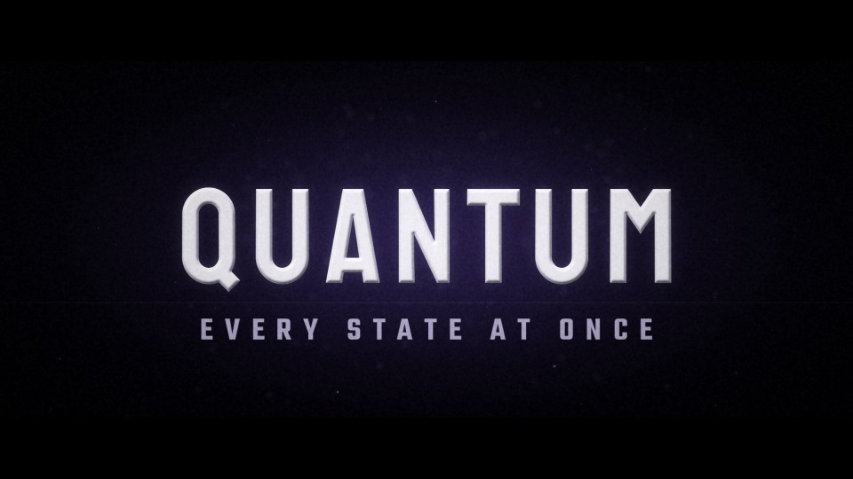

# T24 - Quantum Split

**Category:** E - Sci-Fi and Futuristic Motion Graphics  |  **Duration:** 156 frames (6.50s @ 24 fps)  |  **Depth:** 2.5D



The title exists in three states at once: its RGB channels sit on separate depth planes and collapse into one.

## Animation structure

| Phase | Default frames | What happens |
|---|---|---|
| Build-up | 0 - 26 | Red, green and blue channel copies of the title float apart on different depth planes (with two faint violet depth echoes) and slide together under a camera yaw that reveals their parallax. |
| Impact / reveal | ~50 | Precisely on the impact frame all planes align into a single white wordmark; a thin light line snaps outward. |
| Hero hold | 50 - 116 | Stable, readable title. Camera: Yaw drift that settles to frontal exactly at alignment; micro shake on the snap. |
| Exit | 116 - 144 | The planes split again in depth (red back, blue forward) and dissolve with a soft defocus. |

**Material / look:** Satin white face with a soft bevel; additive RGB channel planes; violet echo planes.

**Techniques:** RGB channel separation, depth planes, parallax yaw, timed convergence, alignment snap, micro residual fringe, depth split exit

**Depth model:** **2.5D** (layered 2D compositing: masks, offset extrusion stack, parallax, light passes). No 3D geometry.

## Files

| File | Purpose |
|---|---|
| `source/T24_Quantum_Split.setting` | Fusion **macro** (editable title with published controls). Install as an Edit-page title or drag into the Fusion page. |
| `source/T24_Quantum_Split.comp` | Flat Fusion **composition** (58 tools) for Fusion Studio / Resolve Fusion page import. Final node: `Letterbox`. |
| `preview/T24_Quantum_Split.mp4` | 1920x1080 preview from the Python **reference renderer** (see note below). |
| `preview/thumbnail.jpg` | Hero-hold frame. |
| `configuration/render_profile.json` | Preview / 4K final render settings. |
| `configuration/default_params.json` | Reference-renderer defaults (edit + render with `render_title.py`). |
| `documentation/parameters.md` | Every published control and what it drives. |
| `documentation/sound_design.md` | Cue sheet (frames + seconds). |
| `manifest.json` | Machine-readable description and verification status. |

## Change the title text

**In Resolve (Edit page title):** select the clip, open the Inspector > *Title* tab > **Main Title** field. Font, size, letter spacing, line spacing, alignment and colour are next to it. Timing and look sliders (Impact Frame, Exit Start, Glow, Particles, Shake, ...) are on the same page under *Controls*.

**In the Fusion page:** select `MainTitle` (TextPlus) and edit *Styled Text*.

**Reference renderer (no Resolve needed):**
```
python 06_AUTOMATION/Scripts/render_title.py T24 --set MAIN_TITLE="YOUR TITLE" --set SUBTITLE="YOUR LINE" --out my_title.mp4
```

Default font: **Staatliches Regular** (OFL, bundled in `02_SHARED_ASSETS/Fonts/` - install it before opening the macro, or pick any installed font in the Inspector).

## Check in Resolve (unconfirmed input names)

These inputs are set in the macro but their names could not be confirmed against documentation. Fusion ignores unknown inputs when it loads a file, so if one is wrong only that setting falls back to its default. Check these first when you open the template:

`pEmitter.Transform3DOp.Translate.Y`, `pRender.Height`, `pRender.UseFrameFormatSettings`, `pRender.Width`, `pTurbulence.XStrength`, `pTurbulence.YStrength`, `pTurbulence.ZStrength`

## Verification status (honest)

| Level | Status |
|---|---|
| Fusion source parses as Lua table (real Lua interpreter) | PASS |
| Graph structure (connections, expression references, published controls) | PASS |
| Opened / rendered inside DaVinci Resolve or Fusion | **NOT TESTED (DaVinci Resolve/Fusion not available in the build environment)** |
| Preview video rendered and checked (ffprobe, duration, size, non-black) | PASS |

The preview was rendered by this project's Python reference renderer, which implements the same design, timing and controls but is **not** Fusion. Expect the Fusion render to differ in detail (noise character, particle look, glow falloff). See `COMPATIBILITY_REPORT.md` at the project root.
