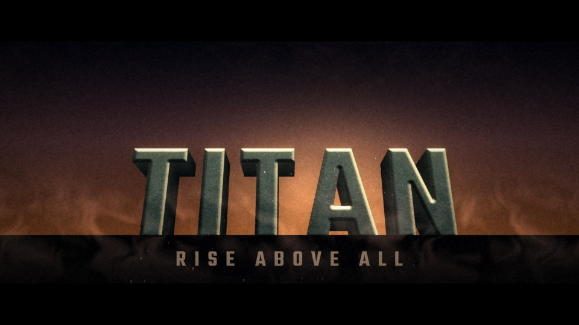

# T27 - Low-Angle Titan

**Category:** F - Cinematic Typography and Camera Movement  |  **Duration:** 240 frames (10.00s @ 24 fps)  |  **Depth:** 2.5D



We stand at the foot of a colossal monument: the name towers over us against a dusk sky.

## Animation structure

| Phase | Default frames | What happens |
|---|---|---|
| Build-up | 0 - 62 | Low camera near the ground: the giant lettering rises up into frame from below the horizon while the camera cranes up and the steep upward perspective slowly eases. |
| Impact / reveal | ~116 | At the impact frame the monument crests into full view - a low rumble, grit trickles off the letter tops and the setting sun rims the top edges. |
| Hero hold | 116 - 200 | Stable, readable title. Camera: Worm's-eye 2.5D perspective (tilt + wide lens), slow crane with a long ease; one restrained rumble. |
| Exit | 200 - 232 | Haze rolls in across the ground and the monument drains to a silhouette, then into the dusk. |

**Material / look:** Weathered verdigris bronze with stone-like pitting; thick perspective extrusion showing the underside.

**Techniques:** worm's-eye perspective, perspective extrusion (underside), rising crane reveal, dusk sky, ground haze, grit fall, silhouette exit

**Depth model:** **2.5D** (layered 2D compositing: masks, offset extrusion stack, parallax, light passes). No 3D geometry.

## Files

| File | Purpose |
|---|---|
| `source/T27_Low_Angle_Titan.setting` | Fusion **macro** (editable title with published controls). Install as an Edit-page title or drag into the Fusion page. |
| `source/T27_Low_Angle_Titan.comp` | Flat Fusion **composition** (60 tools) for Fusion Studio / Resolve Fusion page import. Final node: `Letterbox`. |
| `preview/T27_Low_Angle_Titan.mp4` | 1920x1080 preview from the Python **reference renderer** (see note below). |
| `preview/thumbnail.jpg` | Hero-hold frame. |
| `configuration/render_profile.json` | Preview / 4K final render settings. |
| `configuration/default_params.json` | Reference-renderer defaults (edit + render with `render_title.py`). |
| `documentation/parameters.md` | Every published control and what it drives. |
| `documentation/sound_design.md` | Cue sheet (frames + seconds). |
| `manifest.json` | Machine-readable description and verification status. |

## Change the title text

**In Resolve (Edit page title):** select the clip, open the Inspector > *Title* tab > **Main Title** field. Font, size, letter spacing, line spacing, alignment and colour are next to it. Timing and look sliders (Impact Frame, Exit Start, Glow, Particles, Shake, ...) are on the same page under *Controls*.

**In the Fusion page:** select `MainTitle` (TextPlus) and edit *Styled Text*.

**Reference renderer (no Resolve needed):**
```
python 06_AUTOMATION/Scripts/render_title.py T27 --set MAIN_TITLE="YOUR TITLE" --set SUBTITLE="YOUR LINE" --out my_title.mp4
```

Default font: **Teko SemiBold** (OFL, bundled in `02_SHARED_ASSETS/Fonts/` - install it before opening the macro, or pick any installed font in the Inspector).

## Verification status (honest)

| Level | Status |
|---|---|
| Fusion source parses as Lua table (real Lua interpreter) | PASS |
| Graph structure (connections, expression references, published controls) | PASS |
| Opened / rendered inside DaVinci Resolve or Fusion | **NOT TESTED (DaVinci Resolve/Fusion not available in the build environment)** |
| Preview video rendered and checked (ffprobe, duration, size, non-black) | PASS |

The preview was rendered by this project's Python reference renderer, which implements the same design, timing and controls but is **not** Fusion. Expect the Fusion render to differ in detail (noise character, particle look, glow falloff). See `COMPATIBILITY_REPORT.md` at the project root.
