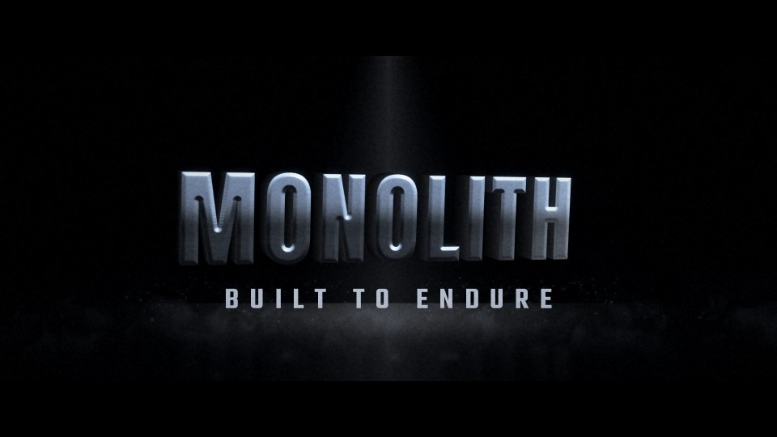

# T28 - Rotating Monolith

**Category:** F - Cinematic Typography and Camera Movement  |  **Duration:** 204 frames (8.50s @ 24 fps)  |  **Depth:** 3D



The title is a solid graphite monolith that turns out of darkness under a single overhead shaft of light.

## Animation structure

| Phase | Default frames | What happens |
|---|---|---|
| Build-up | 0 - 48 | The extruded title approaches from depth almost edge-on (78 deg yaw, pitched back 18 deg) and rotates on two axes into view - a weighty oblique turn, never a flat spin. |
| Impact / reveal | ~90 | At the impact frame the rotation locks at a three-quarter angle (thickness still visible); the overhead light flares across the bevels and floor dust lifts. |
| Hero hold | 90 - 168 | Stable, readable title. Camera: Real 3D: Camera3D slowly arcs (x-offset) while the solid rotates; light shaft stays fixed. |
| Exit | 168 - 198 | The monolith keeps turning to edge-on and recedes into the dark while the light shaft closes. |

**Material / look:** Brushed graphite with silver bevels, cool rim; extrusion sides in deep graphite.

**Techniques:** Text3D + Renderer3D, two-axis oblique rotation, perspective extrusion, overhead light shaft, floor reflection, floor dust, edge-on exit

**Depth model:** **Genuine 3D** in the Fusion source (Text3D extrusion + Blinn material + lights + Camera3D + Renderer3D).

## Files

| File | Purpose |
|---|---|
| `source/T28_Rotating_Monolith.setting` | Fusion **macro** (editable title with published controls). Install as an Edit-page title or drag into the Fusion page. |
| `source/T28_Rotating_Monolith.comp` | Flat Fusion **composition** (43 tools) for Fusion Studio / Resolve Fusion page import. Final node: `Letterbox`. |
| `preview/T28_Rotating_Monolith.mp4` | 1920x1080 preview from the Python **reference renderer** (see note below). |
| `preview/thumbnail.jpg` | Hero-hold frame. |
| `configuration/render_profile.json` | Preview / 4K final render settings. |
| `configuration/default_params.json` | Reference-renderer defaults (edit + render with `render_title.py`). |
| `documentation/parameters.md` | Every published control and what it drives. |
| `documentation/sound_design.md` | Cue sheet (frames + seconds). |
| `manifest.json` | Machine-readable description and verification status. |

## Change the title text

**In Resolve (Edit page title):** select the clip, open the Inspector > *Title* tab > **Main Title** field. Font, size, letter spacing, line spacing, alignment and colour are next to it. Timing and look sliders (Impact Frame, Exit Start, Glow, Particles, Shake, ...) are on the same page under *Controls*.

**In the Fusion page:** select `MainTitle` (TextPlus, or the Text3D node) and edit *Styled Text*.

**Reference renderer (no Resolve needed):**
```
python 06_AUTOMATION/Scripts/render_title.py T28 --set MAIN_TITLE="YOUR TITLE" --set SUBTITLE="YOUR LINE" --out my_title.mp4
```

Default font: **Anton Regular** (OFL, bundled in `02_SHARED_ASSETS/Fonts/` - install it before opening the macro, or pick any installed font in the Inspector).

## Verification status (honest)

| Level | Status |
|---|---|
| Fusion source parses as Lua table (real Lua interpreter) | PASS |
| Graph structure (connections, expression references, published controls) | PASS |
| Opened / rendered inside DaVinci Resolve or Fusion | **NOT TESTED (DaVinci Resolve/Fusion not available in the build environment)** |
| Preview video rendered and checked (ffprobe, duration, size, non-black) | PASS |

The preview was rendered by this project's Python reference renderer, which implements the same design, timing and controls but is **not** Fusion. Expect the Fusion render to differ in detail (noise character, particle look, glow falloff). See `COMPATIBILITY_REPORT.md` at the project root.
