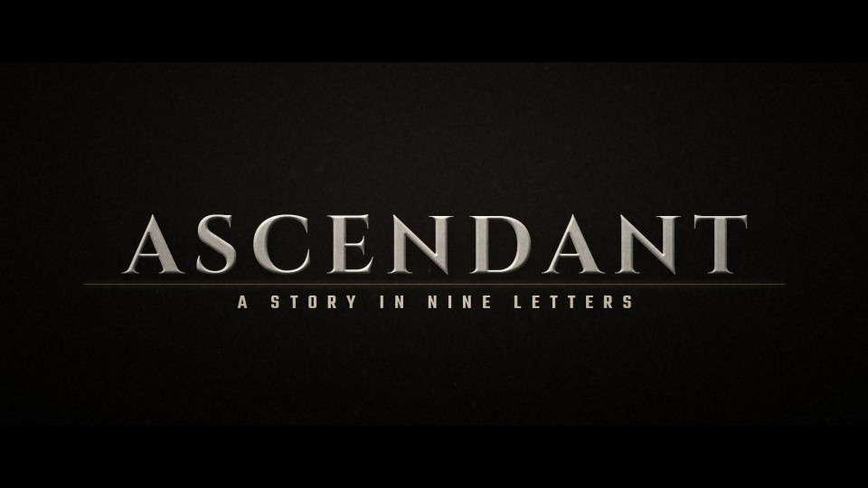

# T29 - Cinematic Letter Assembly

**Category:** F - Cinematic Typography and Camera Movement  |  **Duration:** 180 frames (7.50s @ 24 fps)  |  **Depth:** 2.5D



An elegant credit-style build: each letter flies in on its own arc and clicks into place on a light rule.

## Animation structure

| Phase | Default frames | What happens |
|---|---|---|
| Build-up | 0 - 22 | Letters travel in individually from depth on curved, rotating paths. Outer letters arrive first, alternating sides, with a designed non-uniform rhythm; the centre letter lands last. |
| Impact / reveal | ~82 | Each landing ticks a glint on the champagne baseline; at the impact frame the rule flashes and a sheen crosses the word. |
| Hero hold | 82 - 140 | Stable, readable title. Camera: Gentle locked-off push; depth comes from the letters' own 3D arcs. |
| Exit | 140 - 168 | Letters lift away in reverse order with the same rhythm, rotating back into depth. |

**Material / look:** Ivory porcelain lettering with a soft bevel; champagne (ACCENT) baseline rule and glints.

**Techniques:** per-glyph 3D arcs (preview), slot-based stagger (Fusion), designed rhythm, landing glints, baseline rule draw, sheen sweep, staggered reverse exit

**Depth model:** **2.5D** (layered 2D compositing: masks, offset extrusion stack, parallax, light passes). No 3D geometry.

## Files

| File | Purpose |
|---|---|
| `source/T29_Cinematic_Letter_Assembly.setting` | Fusion **macro** (editable title with published controls). Install as an Edit-page title or drag into the Fusion page. |
| `source/T29_Cinematic_Letter_Assembly.comp` | Flat Fusion **composition** (81 tools) for Fusion Studio / Resolve Fusion page import. Final node: `Letterbox`. |
| `preview/T29_Cinematic_Letter_Assembly.mp4` | 1920x1080 preview from the Python **reference renderer** (see note below). |
| `preview/thumbnail.jpg` | Hero-hold frame. |
| `configuration/render_profile.json` | Preview / 4K final render settings. |
| `configuration/default_params.json` | Reference-renderer defaults (edit + render with `render_title.py`). |
| `documentation/parameters.md` | Every published control and what it drives. |
| `documentation/sound_design.md` | Cue sheet (frames + seconds). |
| `manifest.json` | Machine-readable description and verification status. |

## Change the title text

**In Resolve (Edit page title):** select the clip, open the Inspector > *Title* tab > **Main Title** field. Font, size, letter spacing, line spacing, alignment and colour are next to it. Timing and look sliders (Impact Frame, Exit Start, Glow, Particles, Shake, ...) are on the same page under *Controls*.

**In the Fusion page:** select `MainTitle` (TextPlus) and edit *Styled Text*.

**Reference renderer (no Resolve needed):**
```
python 06_AUTOMATION/Scripts/render_title.py T29 --set MAIN_TITLE="YOUR TITLE" --set SUBTITLE="YOUR LINE" --out my_title.mp4
```

Default font: **Cinzel Bold** (OFL, bundled in `02_SHARED_ASSETS/Fonts/` - install it before opening the macro, or pick any installed font in the Inspector).

## Template-specific controls

| Reference-renderer parameter | Default | Meaning |
|---|---|---|
| `STAGGER_FRAMES` | 4 | Base interval between letter arrivals (frames) |

The matching Fusion sliders are listed in `documentation/parameters.md`.

## Fusion notes and limitations

- Per-letter animation: the preview animates every glyph on its own 3D arc. Fusion's per-character Text+ Follower could not be verified offline, so the Fusion graph keeps ONE editable Text+ and staggers 8 vertical slices ('LetterSlot0..7', RectangleMask slots across the title width) instead. For other title lengths, adjust the slot masks' Center/Width to match the letters.
- Extra control 'Stagger Interval (frames)' (StaggerFrames) sets the base interval between arrivals; the designed rhythm multiplies it per slot. 'Reveal Duration' (AnimDuration) is the travel time of each letter/slot. In the reference renderer the same control is STAGGER_FRAMES.

## Check in Resolve (unconfirmed input names)

These inputs are set in the macro but their names could not be confirmed against documentation. Fusion ignores unknown inputs when it loads a file, so if one is wrong only that setting falls back to its default. Check these first when you open the template:

`pEmitter.Transform3DOp.Translate.Y`, `pRender.Height`, `pRender.UseFrameFormatSettings`, `pRender.Width`, `pTurbulence.XStrength`, `pTurbulence.YStrength`, `pTurbulence.ZStrength`

## Verification status (honest)

| Level | Status |
|---|---|
| A. Fusion source structure (real Lua parse, connections, expressions, published controls) | PASS / PASS |
| B. Standalone Python preview (ffprobe, duration, size, motion, exposure) | PASS |
| C. Composition loads in DaVinci Resolve | **BLOCKED** |
| D. Renders in DaVinci Resolve | **BLOCKED** |
| E. Text and controls editable in Resolve | **BLOCKED** |
| F. Visual comparison Resolve vs. preview | **BLOCKED** |

Resolve status: BLOCKED - not tested in DaVinci Resolve: no Resolve connection in the environment of run cloud_build_env_20261011 (see 06_AUTOMATION/Validation/resolve_test_results.json). To test it on your machine, see `06_AUTOMATION/Resolve/README.md`.

The preview was rendered by this project's Python reference renderer, which implements the same design, timing and controls but is **not** Fusion. Expect the Fusion render to differ in detail (noise character, particle look, glow falloff). See `COMPATIBILITY_REPORT.md` at the project root.
